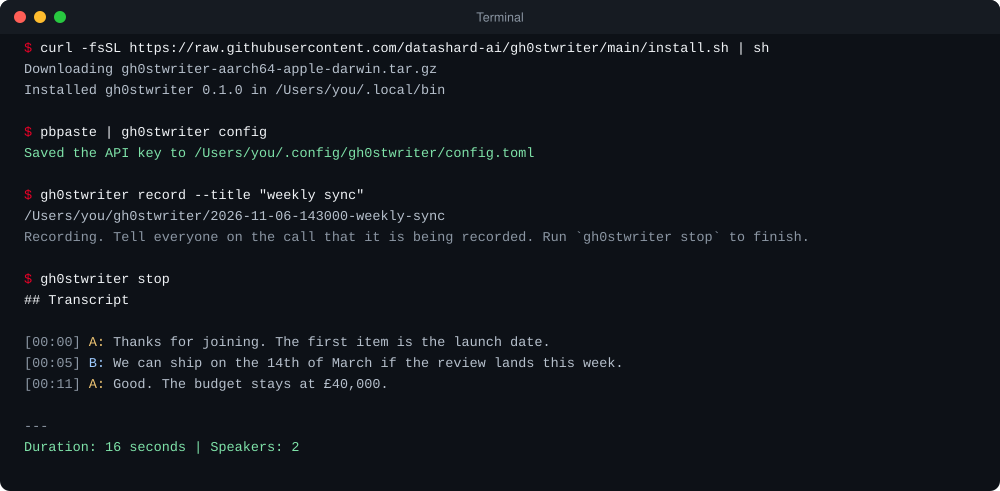
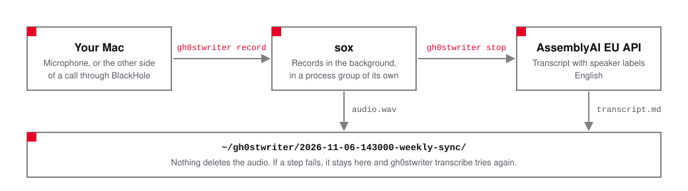

<h1 align="center">
  <br>
  <a href="https://github.com/datashard-ai/gh0stwriter">
    <picture>
      <source media="(prefers-color-scheme: dark)" srcset="assets/logo-dark.png">
      <source media="(prefers-color-scheme: light)" srcset="assets/logo-light.png">
      
    </picture>
  </a>
</h1>

<h4 align="center">Record a call on your Mac and get a transcript, from AssemblyAI or on the Mac itself</h4>

<p align="center">
  <a href="https://github.com/datashard-ai/gh0stwriter/releases/latest"></a>
  
  
  <a href="LICENSE.md"></a>
</p>

<p align="center">
  
</p>

<p align="center">
  <a href="#quick-start">Quick Start</a> •
  <a href="#key-features">Key Features</a> •
  <a href="#how-it-works">How It Works</a> •
  <a href="#choose-the-engine">Choose the Engine</a> •
  <a href="#the-key">The Key</a> •
  <a href="#commands">Commands</a> •
  <a href="#both-sides-of-a-call">Both Sides of a Call</a> •
  <a href="#using-it-with-claude-code-or-another-agent">With an Agent</a> •
  <a href="#from-the-menu-bar">Menu Bar</a> •
  <a href="#where-files-go">Where Files Go</a> •
  <a href="#privacy">Privacy</a> •
  <a href="#troubleshooting">Troubleshooting</a>
</p>

<p align="center">
  gh0stwriter records a call with <a href="https://sox.sourceforge.net/">sox</a> and transcribes it with AssemblyAI's EU API (English,
  with speaker labels) or, if you choose, on your Mac itself, with nothing sent anywhere. It keeps both the audio and the transcript in a
  folder on your Mac. It is one program with seven commands: <code>record</code>, <code>stop</code>, <code>transcribe</code>,
  <code>speakers</code>, <code>config</code>, <code>model</code> and <code>doctor</code>.
</p>

> **Before you rely on it:** with the AssemblyAI engine your audio goes to AssemblyAI's EU API, but where AssemblyAI stores uploads made through that endpoint is not confirmed (see [Privacy](#privacy)). The local engine sends nothing anywhere. Recording both sides of a call has not been tried yet with a real BlackHole setup (see [Both sides of a call](#both-sides-of-a-call)).

## Quick start

You need a Mac with Apple silicon that runs **macOS 14 or later**, and [Homebrew](https://brew.sh/). For the AssemblyAI engine you also need an API key from [AssemblyAI](https://www.assemblyai.com/); the local engine needs no key, but about 2.3 GiB of disk for its speech model, 102 MiB more for its speaker model, and 6 GiB of free memory while it works.

```sh
brew install sox
curl -fsSL https://raw.githubusercontent.com/datashard-ai/gh0stwriter/main/install.sh | sh
```

The installer asks which engine to use (type 1 for AssemblyAI, 2 for the local engine, or press Enter to leave it as it is). With the local engine it then downloads the speech model and the speaker model, once. The installer puts a folder, `gh0stwriter-lib/`, beside the program (NVIDIA's libraries: the program does not start without it), and replaces it whole when you install again. It tries the new program before it replaces the old one, and puts the old one back if the new one does not run. When the engine is already local, it also runs `gh0stwriter model`, so that an upgrade gets the speaker model. To answer in advance, or when there is no terminal to ask, add options: `... | sh -s -- --engine local` or `--engine assemblyai`, and `--no-model` to skip the model download (run `gh0stwriter model` later).

```sh
pbpaste | gh0stwriter config        # AssemblyAI engine only: saves the API key you copied
gh0stwriter record --title "weekly sync"
gh0stwriter stop                    # transcribes, then prints the transcript
gh0stwriter doctor                  # checks that this Mac has what the chosen engine needs
```

The installer downloads the release for your Mac, checks it against its published checksum, and copies `gh0stwriter` and `mlx.metallib` (the local engine's compiled Metal kernels, which must stay beside it) to `~/.local/bin`. Set `GH0STWRITER_INSTALL_DIR` to use another folder, or `GH0STWRITER_VERSION` to pin a version. gh0stwriter does not install sox for you. Releases up to 0.1.1 run on macOS 11 or later and have no local engine; on an older Mac, `GH0STWRITER_VERSION=0.1.1` installs the last of them.

## Key features

- **It keeps recording after the command returns.** `record` starts sox in a process group of its own and comes back within about a second, so the shell call that started it does not have to last as long as the meeting.
- **It never deletes your audio.** A failed upload, a failed transcription or a crash leaves the recording where it is, and `transcribe` tries again.
- **A named input to record from.** Record from the microphone you name, or the Mac's default input.
- **You against the call, and who said what.** With the call's sound sent through BlackHole and `call_device` set, your microphone and the call are recorded as two tracks. This has not been tried yet on a real call (see [Both sides of a call](#both-sides-of-a-call)). With the local engine, your words are `You`, the call's track is split into its speakers on your Mac, which finds how many there are, and `gh0stwriter speakers` gives each a name and a side (`us`, `client` or `other`). A recording of one track, or an audio file, has its speakers told apart the same way, as `Speaker 1`, `Speaker 2` and so on, with no `You`. Nothing about a voice is stored.
- **Two engines.** AssemblyAI's EU API gives transcripts with speaker labels, in English. The local engine transcribes on your Mac's GPU with NVIDIA's Parakeet model: no key, no connection while it works, and speaker labels for every recording, found on your Mac (see [Both sides of a call](#both-sides-of-a-call)). Both write `transcript.md`. Where AssemblyAI stores uploads is not confirmed: see [Privacy](#privacy).
- **Private by default.** Folders are mode 0700 and files 0600, and the API key is kept in a file only you can read (or in `ASSEMBLYAI_API_KEY`).
- **Careful with processes.** gh0stwriter only signals a process it has confirmed is its own sox, and it refuses to start a second recording, or to transcribe one that may still be running.

## How it works

<p align="center">
  <picture>
    <source media="(prefers-color-scheme: dark)" srcset="assets/flow-dark.svg">
    
  </picture>
</p>

`gh0stwriter record` starts sox and returns. `gh0stwriter stop` ends sox so it can finish the audio file, then transcribes it: with the AssemblyAI engine it uploads the audio and waits for the transcript, with the local engine it transcribes on your Mac. It saves the transcript next to the audio. Each recording gets its own folder, so nothing is ever overwritten or lost.

## Choose the engine

| | AssemblyAI (the default) | Local |
| --- | --- | --- |
| Where it runs | AssemblyAI's EU API | your Mac's GPU, with NVIDIA's Parakeet TDT 0.6B v3 |
| Needs | the API key | the speech model on disk (`gh0stwriter model`, 2.3 GiB, once) and the speaker model (102 MiB, the same command), and `mlx.metallib` and `gh0stwriter-lib/` beside the program |
| Sends | the audio, to AssemblyAI | nothing, anywhere |
| Speaker labels | yes | found on your Mac, and how many there are too (up to 8): `Speaker 1`, `Speaker 2`, ... on one track, with no `You`; `You` and the call's speakers on two tracks (see [Both sides of a call](#both-sides-of-a-call)). If the split fails, on one track there are none and the closing line says `Speakers: 0`, and on two tracks it is `You` and `Others` |
| Reads | whatever AssemblyAI takes | 16 kHz mono 16-bit WAV, which is what `record` writes |

```sh
gh0stwriter config --engine local        # use the local engine from now on
gh0stwriter config --engine assemblyai   # back to AssemblyAI (the default)
gh0stwriter stop --engine local          # one run only, whatever the setting says
gh0stwriter transcribe call.wav --engine assemblyai
```

`gh0stwriter model` downloads the speech model and the speaker model (NVIDIA's Nemotron 3 Diarization, OpenMDW-1.1, 102 MiB) from Hugging Face into `~/.local/share/gh0stwriter/models/`, checks each against a published checksum, and does nothing for one that is there already; if it is cut off, run it again and it carries on. The speaker models of an earlier release, in a folder named `speakers-…`, are not used any more: remove it by hand if you like. It is the only thing that downloads the models, and `transcribe` never does. `record` has no `--engine`: it follows the setting, and with the local engine it needs no key; with no speaker model yet, it warns and records anyway, so that you can run `gh0stwriter model` before `gh0stwriter stop`.

The local engine reads one chunk of the audio at a time and is meant to stay within 6 GiB of memory: a 3-hour two-track recording peaked at 6.28 GB on an Apple M5 Ultra, and the check on a 16 GB Mac is still to be done. **A call is limited to 3 hours**: `record` stops at 3 hours, and the local engine refuses a longer recording, keeps the audio and names the command to use the AssemblyAI engine on it instead. On a public 17-minute test meeting (the AMI corpus's ES2004a, an M1 Pro with 16 GB) it transcribed in about 16 seconds and made roughly 19 mistakes per 100 words with filler sounds ignored; expect more on poor audio.

A local transcript has a `## Speakers` list, then the `## Transcript` heading and one `[MM:SS] <speaker>: <text>` paragraph per speaker turn with a blank line between (the minutes keep counting past an hour, as in `[62:05]`), and a last line `Duration: N seconds | Speakers: N`. If the split of the speakers of one track fails, the transcript has no list and one `[MM:SS] <sentence>` paragraph per sentence, and the last line says `Speakers: 0`; on two tracks a failed split leaves `You` and `Others`, under their list. A recording with no speech in it gives an empty transcript and a line on standard error saying so.

## The key

`gh0stwriter config` reads one line from standard input and saves it to `~/.config/gh0stwriter/config.toml` (mode 0600, in a folder with mode 0700). Piping it from the clipboard keeps the key off the screen: if you run `gh0stwriter config` on its own, what you type is visible. Instead of the file you can set `ASSEMBLYAI_API_KEY`; when it is set and not empty it wins over the file. With the AssemblyAI engine and without a key, `record`, `stop` and `transcribe` exit with code 2.

The file can also name the input to record from:

```toml
api_key = "..."
device = "..."        # optional: your microphone, see "Both sides of a call"
call_device = "..."   # optional: the device the call's sound reaches, such as "BlackHole 2ch"; this switches two tracks on
engine = "..."        # optional: "assemblyai" (the default) or "local"
mic_channels = 1      # optional: your microphone's input channels (1 to 8, default 1)
call_channels = 2     # optional: the call device's input channels (1 to 8, default 2)
```

The engine is saved there too, as `engine = "assemblyai"` or `engine = "local"` (exactly these words; no `engine` means AssemblyAI). `gh0stwriter config --engine local` writes it for you. Any other word stops `record`, `stop` and `transcribe` with exit code 1, naming the file.

Running `config` again replaces the key and keeps `device`, `call_device`, `engine`, `mic_channels` and `call_channels`, but it rewrites the file from those six settings alone, so any comments or other lines in it are lost. The local engine needs no key.

## Commands

```text
gh0stwriter record [--title TITLE] [--minutes N] [--device NAME] [--call-device NAME]
gh0stwriter stop [RUN] [--quiet] [--engine assemblyai|local] [--others N]
gh0stwriter transcribe <RUN|FILE> [--quiet] [--engine assemblyai|local] [--others N]
gh0stwriter speakers <RUN> [KEY=SIDE:NAME ...]
gh0stwriter config [--engine assemblyai|local]
gh0stwriter model
gh0stwriter doctor
```

- **`record`** starts sox in the background and returns once it has heard the first second of audio, which takes about a second, or up to 10 seconds when the input sends nothing yet. It prints the run folder (the folder that holds this call's files) on standard output. `--title` names the folder, `--minutes N` makes sox stop by itself after N minutes, `--device` picks the input, and `--call-device` the call's device to record beside it. Only one recording runs at a time: while the newest one is still running, `record` exits with code 4. A second `record` started at the same moment waits for the first to finish starting, using a lock on `.record.lock` in the home folder (up to 10 seconds, then it exits with code 4), and is then refused in the same way. What `record` does with that first second depends on what it heard. If the default input gave only silence, macOS has most likely not allowed this terminal the microphone (a muted microphone gives silence too), so `record` stops sox, keeps the run folder and exits with code 4: unmute the microphone, or name the input with `--device` to record from it anyway. If a named `--device` (or the `device` setting) gave only silence, `record` prints a warning and keeps recording, because a loopback device such as BlackHole is silent until something plays through it. If that input is your microphone, that silence may mean your side of the call is missing; to record both sides of a call, use `call_device` (see "Both sides of a call"). If the first full second of audio has not arrived within 10 seconds, `record` warns that it could not check the input, keeps recording and returns; macOS may still be asking whether to allow the microphone.
- **`stop`** ends the recording with SIGINT, which makes sox finish the audio file (it waits up to 15 seconds), then transcribes it. `RUN` is a run folder, as a path or as its name under the home folder; leave it out for the newest recording that has no saved transcript yet. If the transcription fails, `stop` with no argument finds the same recording again. If the recording is only silence, `stop` sends nothing to AssemblyAI, keeps the audio and exits with code 4.
- **`transcribe`** takes a run folder or an audio file. A file is copied into a new run folder, so the original is left alone. Use it to try again after a failure: the error message names the audio and the exact command to run. It refuses a run whose sox is still recording, and a 16-bit WAV that holds only silence (it sends nothing and exits with code 4). Audio in any other format is sent as it is.
- **`stop` and `transcribe` print the transcript** on standard output unless you pass `--quiet`. `transcript.md` is written either way. `--engine` picks the engine for that run. `--others N` is no longer needed and is ignored (see [Both sides of a call](#both-sides-of-a-call)).
- **`speakers`** lists a transcript's speakers with their first lines, or names them, each with a side (see [Both sides of a call](#both-sides-of-a-call)).
- **`config`** saves the AssemblyAI key from one line of standard input; with `--engine` it saves the engine instead and reads no key.
- **`model`** downloads the local engine's speech model (2.3 GiB) and its speaker model (102 MiB), once.
- **`doctor`** lists what this Mac has and lacks: the program, sox, the engine in use, the key, the speech model, the speaker model and `mlx.metallib`, one line each (`ok`, `warn`, `FAIL` or `info`), with a `fix:` line under each problem. It exits 1 when something the chosen engine needs is missing, and changes nothing. The key is never printed.

Both commands wait for AssemblyAI for up to 10 minutes plus half the length of the audio, checking every 3 seconds. A check that fails because of the network, a timeout, an HTTP 5xx or 429 reply, or a reply that cannot be read is tried again at the next check; the wait ends after the sixth such failure in a row. If the wait fails or runs out, the command exits with code 5 and the audio stays where it is. They do not return until the transcript is saved, which for a long recording can take minutes.

`transcript.md` holds a `## Transcript` heading, one `[MM:SS] <speaker>: <text>` paragraph per speaker turn, and a last line such as `Duration: 45 seconds | Speakers: 2`. A transcript with speakers also has a `## Speakers` list above it.

## Both sides of a call

sox records your microphone. To record the call as well, send the call's sound to a loopback device, BlackHole, and record it as a second track beside the microphone.

This setup has not been tried yet on a real call. What has been checked is one sox merging two devices, as `record` runs it, for 3 seconds on a MacBook Pro with its microphone and another input.

1. Install a loopback driver once: `brew install blackhole-2ch`. gh0stwriter does not install BlackHole, or anything else, for you.
2. In Audio MIDI Setup, make a Multi-Output device of your headphones (or speakers) and BlackHole 2ch, and set it as the Mac's sound output. Use headphones (see below).
3. In Audio MIDI Setup, give BlackHole 2ch the same sample rate as your microphone (48,000 Hz for a MacBook Pro's): sox stops with "Input files must have the same sample-rate" when they differ.
4. Name BlackHole as the call's device, once, with `call_device = "BlackHole 2ch"` in `~/.config/gh0stwriter/config.toml`, or for one recording with `gh0stwriter record --call-device "BlackHole 2ch"`.

No Aggregate device is needed, and none should be used: sox reads an Aggregate device as one stream, so its microphone and BlackHole are not kept apart.

### Two tracks: you and the call

```toml
call_device = "BlackHole 2ch"   # this switches two tracks on
mic_channels = 1                # your microphone's input channels (the default)
call_channels = 2               # BlackHole 2ch has two (the default)
```

With a call's device, one sox records your microphone (`--device` or `device`, else the Mac's default input) and the call's device into one file, your channels first. Without one, recording is one channel, as before. `--call-device` wins over `call_device`, and a name that starts with `-` is refused. Both counts are whole numbers from 1 to 8. If the file's channels are not `mic_channels + call_channels`, `record` stops sox, keeps the run folder and exits with code 4, naming both devices and the settings to change. `record` writes `tracks.toml` in the run folder before it starts sox, so changing the settings later does not change an earlier recording. The local engine transcribes each track on its own, labels yours `You` and merges both by time; a track silent from start to end is skipped, with a line saying so. The AssemblyAI engine gets a mono mix in which your track and the call's weigh the same, in `upload.wav`, which is removed after the upload (a run interrupted during it leaves the file until the next `transcribe` of that run replaces it); `audio.wav` is never changed.

If your microphone's channel is silent in the first second, `record` warns that your side of the call is not being recorded and keeps recording: check the terminal's microphone permission, and that `device` names your microphone. BlackHole is silent until something plays, so the call's channels are not checked then.

The microphone and BlackHole each run on their own clock, and nothing corrects the drift between them, so on a long call the two tracks may drift apart by a fraction of a second. This has not been measured yet.

**Wear headphones.** Over loudspeakers the microphone also hears the call, so the others' words appear a second time, labelled `You`. A colleague of yours on the call is in the call's track; naming the speakers tells them from the client.

### Telling the others apart

With the local engine, every recording has its speakers told apart on your Mac before it is transcribed: the call's track of a two-track recording, and the one track of a recording with no `call_device` or of an audio file given to `transcribe`. You do not say how many: NVIDIA's Nemotron 3 Diarization finds how many people speak (up to 8) and who speaks when, and `gh0stwriter model` downloads it with the speech model. When it finds one speaker, the call's track is `Others`. On one track there is no `You`, because nothing separates your voice from the rest: the speakers are `Speaker 1`, `Speaker 2` and so on, in the order they first speak, `gh0stwriter speakers` names them, and one voice is `Speaker 1`, never `Others`. `stop` and `transcribe` say "telling the call's speakers apart…" while they work on two tracks, and "telling the speakers apart…" on one. If the split itself fails while it runs, the transcript is not lost: the call's track is labelled `Others`, one line on standard error says why ("the call's speakers could not be told apart (…): the call's track is labelled Others"), and the exit code is 0. On one track, a split that fails leaves the plain transcript with no speaker labels, with the line "the speakers could not be told apart (…): the transcript has no speaker labels", and the exit code is 0 as well. `gh0stwriter model` checks the speaker model file against its published checksum, and downloads it again, keeping the old folder beside it, when it is not that file. If it finds more or fewer speakers than there were, `gh0stwriter speakers` lets you give two of them the same name; a call with more than 8 other voices has some of them folded together; two people with similar voices may be merged.

`--others N`, which the last release used to give the number, is no longer needed. `stop --others 3` and `transcribe RUN --others 3` still run on a two-track recording with the local engine: the number is ignored, with one line saying so on standard error. With AssemblyAI, or on a recording that has no `tracks.toml`, or on an audio file, it is refused with exit code 1 before anything is sent, as before. Without the speaker model, `stop` and `transcribe` of any recording with the local engine, one track or two, exit with code 2 and name `gh0stwriter model`, and a recording that `stop` was going to end is still running; no run folder is made for an audio file.

A transcript with speakers starts with a list, and each line carries a label:

```text
## Speakers

- you: You
- 1: Speaker 1
- 2: Speaker 2

## Transcript

[00:03] You: Hello, Alice.

[00:07] Speaker 1: Hi, Bob.
```

### Naming the speakers: `gh0stwriter speakers`

```sh
gh0stwriter speakers <RUN>
gh0stwriter speakers <RUN> you=us:Alice 1=client:Bob 2=client:Carol
```

With no names it prints each speaker, as `key: label`, and the speaker's first two lines. With names, each is `KEY=SIDE:NAME`: the key is the one in the list (`you`, `others`, a number, or an AssemblyAI letter), the side is `us`, `client` or `other`, and the label becomes `NAME (SIDE)`, such as `Bob (client)`, in the list and on every line of that speaker in `transcript.md`. Run it again to change names. Two keys may be given the same name and side when the split cut one person in two; they cannot be told apart afterwards, and naming them differently exits with code 1. A key that is not in the transcript, a side that is not one of the three, an empty name, or a run with no transcript also exit with code 1 and change nothing.

**Nothing about a voice is stored.** The voice embeddings that tell the speakers apart exist in memory only while one call's track is split. They are never written to disk or compared with another call, and nobody enrolls. What is kept is the names you type, in `transcript.md`. The participants must still be told, and a client must still agree to the recording.

## Using it with Claude Code or another agent

`gh0stwriter record` returns within about a second and leaves sox running in a process group of its own, so the shell call that started it does not have to last as long as the meeting. We checked this with a 12-minute recording started from a Claude Code shell call: it was still running when that call had ended, and a later `gh0stwriter stop --quiet` finished it.

`stop` and `transcribe` wait for the transcript, so run them in a terminal for a long call: Claude Code's shell tool gives up on a call after 2 minutes by default and 10 at most. If a call is cut off, the audio is kept, and `gh0stwriter transcribe <run>` tries again. Pass `--quiet` when an agent runs `stop` or `transcribe` and read `transcript.md` yourself: without it the whole transcript is printed into the agent's session. An agent that can run shell commands can also start a recording; which commands it may run is for its permission settings to decide.

## From the menu bar

`ui/gh0stwriter.5s.sh` is a [SwiftBar](https://github.com/swiftbar/SwiftBar) plugin that puts gh0stwriter in the menu bar: **Start recording…** (asks for a title), **Stop & transcribe** (with the elapsed time shown while it records), and your latest and recent transcripts, which open in your text editor. It only calls the commands above, so a recording started in the terminal shows up there too. See [ui/README.md](ui/README.md) to set it up. macOS asks for microphone access again, this time for SwiftBar.

## Where files go

Each recording gets its own folder, `~/gh0stwriter/<YYYY-MM-DD-HHMMSS>-<title>/`, or the same under `GH0STWRITER_HOME` when that is set.

| File | What it is |
| --- | --- |
| `audio.wav` | The recording: 16 kHz, mono, 16-bit, or with a call's device one channel for each microphone and call channel. For a file given to `transcribe`, a copy named `audio.<extension>`. |
| `tracks.toml` | Only for a two-track recording: `mic_channels` and `call_channels`, written when the recording starts. |
| `transcript.md` | The transcript, written by `stop` and `transcribe`. |
| `sox.pid` | The process id of sox. Removed once the transcript is saved. |
| `sox.log` | What sox printed on standard error. |
| `upload.wav` | Only while a two-track run is uploaded to AssemblyAI: the mono mix that is sent, removed after the upload. A run interrupted during the upload leaves it, and only the next AssemblyAI `transcribe` of that run replaces it (a local `transcribe` never makes or removes it). |

Folders are mode 0700 and files 0600. Nothing deletes a recording: failures leave the audio in place, and `transcribe` tries again. If sox is killed, the audio file it leaves is still accepted by AssemblyAI.

## Exit codes

| Code | Meaning |
| --- | --- |
| 0 | Success |
| 1 | Any other error, and a usage error |
| 2 | The chosen engine is not ready: no API key (AssemblyAI), or no speech model or no speaker model (local) |
| 3 | sox not found |
| 4 | Recording problem: sox failed to start or did not stop, a process could not be checked, a recording is already running (`record`) or still running (`transcribe`), no recording was found, the recording is empty, the input gave only silence (`record`), or the recording is silent (`stop`, `transcribe`) |
| 5 | Transcription failed (including audio the local engine cannot read, or a local engine without its `mlx.metallib`), or the transcript could not be saved (the audio is kept) |

## Privacy

**With the local engine nothing leaves your Mac:** the audio is transcribed on it, and gh0stwriter contacts no one while it does. The speakers of a recording are told apart on your Mac too, and nothing about a voice is stored. The only connection is `gh0stwriter model`, which downloads the speech model and the speaker model once from Hugging Face and sends no audio. The local engine does not make a recording any less a recording of other people: tell the participants, and for a client's call make sure the client agrees to it being recorded.

**With the AssemblyAI engine** your audio (for a two-track recording, a mono mix of its channels) and its transcript go to AssemblyAI's EU API, `api.eu.assemblyai.com`. gh0stwriter sends them to no other service, has no server of its own and collects nothing. AssemblyAI documents exceptions to EU residency: its support staff outside the EU may access data for a support request, and file names may be processed by US subprocessors (gh0stwriter uploads the audio without a file name). The upload returns a URL on `cdn.assemblyai.com`, which on Oct 27, 2026 resolved to an Amazon S3 `us-west-2` endpoint, against AssemblyAI's documented statement that audio and transcripts are stored in the endpoint region you select. Where uploads are stored is therefore unresolved. If your audio must not leave the EU, don't use gh0stwriter for it until AssemblyAI confirms in writing where uploads made through the EU endpoint are stored. Transcripts stay at AssemblyAI for 30 days unless they are deleted there, and gh0stwriter does not delete them.

The API key is never printed, never passed on a command line and never written anywhere but the config file. The only host gh0stwriter sends it to is AssemblyAI's EU API.

## Troubleshooting

- **`sox not found` (exit 3):** run `brew install sox`.
- **`the microphone gave only silence` (`record`) or `the recording is silent` (`stop`, `transcribe`), exit 4:** macOS gives silence, not an error, to an app that is not allowed the microphone. In System Settings, Privacy & Security, Microphone, turn on the app this terminal runs in (Terminal, Ghostty, iTerm, VS Code), quit and reopen that app, then record again. If the app is not in the list, or you refused it once and macOS no longer asks, reset its permission with `tccutil reset Microphone <bundle id>`, reopen the app and run `record` again so that macOS asks: Ghostty is `com.mitchellh.ghostty`, Terminal is `com.apple.Terminal` and iTerm is `com.googlecode.iterm2`. A muted microphone gives silence too, and so does a virtual microphone that gates noise while you are quiet: unmute it and record again, or name the input with `--device` to record from it anyway (`record` then only warns). The audio and its run folder are kept; nothing was sent to AssemblyAI.
- **`Warning: the input … gave only silence` (`record --device`), no exit code:** `record` keeps recording, because a loopback device such as BlackHole is silent until something plays through it, so there is nothing to fix if that is what you named. If the input is your microphone, your side of the call may be missing (to record both sides of a call, use `call_device`: see "Both sides of a call"): run `gh0stwriter stop` (it keeps the audio, and sends nothing to AssemblyAI if the recording is only silence), fix the microphone permission as above, then record again.
- **`Warning: your microphone's channel is silent` (`record`, with a call's device), no exit code:** `record` keeps recording, but your side of the call is not being recorded. Check the terminal's microphone permission and that `device` (or `--device`) names your microphone, then run `gh0stwriter stop` and record again.
- **`… give N channels between them, but mic_channels + call_channels is …` (`record`), exit 4:** set `mic_channels` and `call_channels` in `~/.config/gh0stwriter/config.toml` to the input channels of your microphone and of the call's device (Audio MIDI Setup shows them), then record again. The run folder is kept.
- **`Input files must have the same sample-rate` (`record` or `stop`), exit 4:** in Audio MIDI Setup, set BlackHole 2ch to your microphone's sample rate (48,000 Hz for a MacBook Pro's), then record again.
- **`the call's track is silent` (`stop`, `transcribe`), no exit code:** the call did not reach BlackHole. Make the Multi-Output device with BlackHole the Mac's sound output before the next call.
- **`The speaker model is not on this Mac` (`stop`, `transcribe`), exit 2:** run `gh0stwriter model` to download it (102 MiB, once), or use `--engine assemblyai`. Nothing was read or sent, and a recording that `stop` was going to end is still running.
- **`--others needs a two-track recording (call_device) transcribed with the local engine` (exit 1):** `--others` is no longer needed, but where the last release refused it, this one does too: it is for a recording made with a call's device, with the local engine. Nothing was sent, and a recording that `stop` was going to end is still running.
- **`already recording` (exit 4):** run `gh0stwriter stop` first. If the recording is not running any more, `stop` transcribes what it left.
- **`sox did not stop` (exit 4):** the audio is kept. End sox with `kill -INT <pid>` (the message names it), then run `gh0stwriter stop` again.
- **A transcription failed (exit 5):** the audio is kept; run the command the error message names.
- **`Library not loaded: @rpath/libnemo_speech_asr_c.1.dylib` (any command), the program does not start:** the folder `gh0stwriter-lib/` is not beside the program (the installer puts it there). Install again with the installer; if you moved the program by hand, move the folder with it.
- **`gh0stwriter doctor` says FAIL:** the line names what is missing and the `fix:` under it says what to run. With the local engine that is usually `gh0stwriter model` (the speech model is not on this Mac yet, exit 2) or installing gh0stwriter again with its installer (`mlx.metallib` must sit beside the program).
- **The local engine says it cannot read the recording (exit 5):** it reads only 16 kHz mono 16-bit WAV. Convert it with `sox in.m4a -r 16000 -c 1 -b 16 out.wav`, or use `--engine assemblyai`.
- **The local engine says the recording is too long (exit 5):** a call is limited to 3 hours. Use `--engine assemblyai` for it, or cut it.
- **The installer says this Mac is too old:** gh0stwriter needs macOS 14 or later. Nothing was changed; `GH0STWRITER_VERSION=0.1.1` installs the last release for older macOS, which has no local engine.

## Licence

gh0stwriter is proprietary software. Use is subject to [LICENSE.md](LICENSE.md). Third-party components are listed in [THIRD-PARTY-NOTICES.md](THIRD-PARTY-NOTICES.md). sox is a separate program that you install yourself; it is not part of gh0stwriter.
