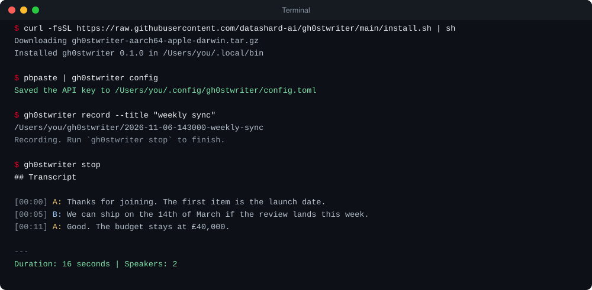
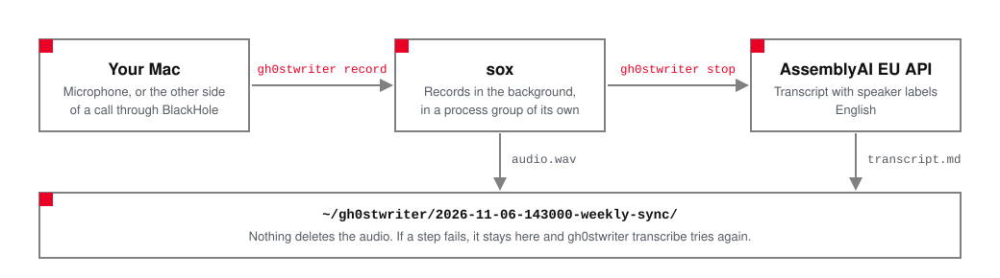

<h1 align="center">
  <br>
  <a href="https://github.com/datashard-ai/gh0stwriter">
    <picture>
      <source media="(prefers-color-scheme: dark)" srcset="assets/logo-dark.png">
      <source media="(prefers-color-scheme: light)" srcset="assets/logo-light.png">
      
    </picture>
  </a>
</h1>

<h4 align="center">Record a call on your Mac and get a transcript with speaker labels</h4>

<p align="center">
  <a href="https://github.com/datashard-ai/gh0stwriter/releases/latest"></a>
  
  
  <a href="LICENSE.md"></a>
</p>

<p align="center">
  
</p>

<p align="center">
  <a href="#quick-start">Quick Start</a> •
  <a href="#key-features">Key Features</a> •
  <a href="#how-it-works">How It Works</a> •
  <a href="#the-key">The Key</a> •
  <a href="#commands">Commands</a> •
  <a href="#both-sides-of-a-call">Both Sides of a Call</a> •
  <a href="#using-it-with-claude-code-or-another-agent">With an Agent</a> •
  <a href="#where-files-go">Where Files Go</a> •
  <a href="#privacy">Privacy</a> •
  <a href="#troubleshooting">Troubleshooting</a>
</p>

<p align="center">
  gh0stwriter records a call with <a href="https://sox.sourceforge.net/">sox</a>, sends the audio to AssemblyAI's EU API to be transcribed
  (English, with speaker labels), and keeps both the audio and the transcript in a folder on your Mac. It is one program with
  four commands: <code>record</code>, <code>stop</code>, <code>transcribe</code> and <code>config</code>.
</p>

> **Before you rely on it:** your audio goes to AssemblyAI's EU API, but where AssemblyAI stores uploads made through that endpoint is not confirmed (see [Privacy](#privacy)). Recording both sides of a call has not been tried yet with a real BlackHole setup (see [Both sides of a call](#both-sides-of-a-call)).

## Quick start

You need a Mac with Apple silicon, [Homebrew](https://brew.sh/), and an API key from [AssemblyAI](https://www.assemblyai.com/).

```sh
brew install sox
curl -fsSL https://raw.githubusercontent.com/datashard-ai/gh0stwriter/main/install.sh | sh
pbpaste | gh0stwriter config        # saves the API key you copied
gh0stwriter record --title "weekly sync"
gh0stwriter stop                    # waits for AssemblyAI, then prints the transcript
```

The installer downloads the release for your Mac, checks it against its published checksum, and copies `gh0stwriter` to `~/.local/bin`. Set `GH0STWRITER_INSTALL_DIR` to use another folder, or `GH0STWRITER_VERSION` to pin a version. gh0stwriter does not install sox for you.

## Key features

- **It keeps recording after the command returns.** `record` starts sox in a process group of its own and comes back within about a second, so the shell call that started it does not have to last as long as the meeting.
- **It never deletes your audio.** A failed upload, a failed transcription or a crash leaves the recording where it is, and `transcribe` tries again.
- **A named input to record from.** Record from a named input, such as an aggregate device built on BlackHole, to capture the other person as well as yourself. This has not been tried yet with a real BlackHole setup (see [Both sides of a call](#both-sides-of-a-call)).
- **Transcripts with speaker labels**, in English, from AssemblyAI's EU API, written to `transcript.md`. Where AssemblyAI stores uploads is not confirmed: see [Privacy](#privacy).
- **Private by default.** Folders are mode 0700 and files 0600, and the API key is kept in a file only you can read (or in `ASSEMBLYAI_API_KEY`).
- **Careful with processes.** gh0stwriter only signals a process it has confirmed is its own sox, and it refuses to start a second recording, or to transcribe one that may still be running.

## How it works

<p align="center">
  <picture>
    <source media="(prefers-color-scheme: dark)" srcset="assets/flow-dark.svg">
    
  </picture>
</p>

`gh0stwriter record` starts sox and returns. `gh0stwriter stop` ends sox so it can finish the audio file, uploads the audio to AssemblyAI, waits for the transcript, and saves it next to the audio. Each recording gets its own folder, so nothing is ever overwritten or lost.

## The key

`gh0stwriter config` reads one line from standard input and saves it to `~/.config/gh0stwriter/config.toml` (mode 0600, in a folder with mode 0700). Piping it from the clipboard keeps the key off the screen: if you run `gh0stwriter config` on its own, what you type is visible. Instead of the file you can set `ASSEMBLYAI_API_KEY`; when it is set and not empty it wins over the file. Without a key, `record`, `stop` and `transcribe` exit with code 2.

The file can also name the input to record from:

```toml
api_key = "..."
device = "..."   # optional, see "Both sides of a call"
```

Running `config` again replaces the key and keeps `device`, but it rewrites the file from those two settings alone, so any comments or other lines in it are lost.

## Commands

```text
gh0stwriter record [--title TITLE] [--minutes N] [--device NAME]
gh0stwriter stop [RUN] [--quiet]
gh0stwriter transcribe <RUN|FILE> [--quiet]
```

- **`record`** starts sox in the background and returns once it has heard the first second of audio, which takes about a second, or up to 10 seconds when the input sends nothing yet. It prints the run folder (the folder that holds this call's files) on standard output. `--title` names the folder, `--minutes N` makes sox stop by itself after N minutes, and `--device` picks the input. Only one recording runs at a time: while the newest one is still running, `record` exits with code 4. A second `record` started at the same moment waits for the first to finish starting, using a lock on `.record.lock` in the home folder (up to 10 seconds, then it exits with code 4), and is then refused in the same way. What `record` does with that first second depends on what it heard. If the default input gave only silence, macOS has most likely not allowed this terminal the microphone (a muted microphone gives silence too), so `record` stops sox, keeps the run folder and exits with code 4: unmute the microphone, or name the input with `--device` to record from it anyway. If a named `--device` (or the `device` setting) gave only silence, `record` prints a warning and keeps recording, because a loopback device such as BlackHole is silent until something plays through it. For an aggregate device that includes a microphone, that silence may mean your side of the call is missing. If the first full second of audio has not arrived within 10 seconds, `record` warns that it could not check the input, keeps recording and returns; macOS may still be asking whether to allow the microphone.
- **`stop`** ends the recording with SIGINT, which makes sox finish the audio file (it waits up to 15 seconds), then transcribes it. `RUN` is a run folder, as a path or as its name under the home folder; leave it out for the newest recording that has no saved transcript yet. If the transcription fails, `stop` with no argument finds the same recording again. If the recording is only silence, `stop` sends nothing to AssemblyAI, keeps the audio and exits with code 4.
- **`transcribe`** takes a run folder or an audio file. A file is copied into a new run folder, so the original is left alone. Use it to try again after a failure: the error message names the audio and the exact command to run. It refuses a run whose sox is still recording, and a 16-bit WAV that holds only silence (it sends nothing and exits with code 4). Audio in any other format is sent as it is.
- **`stop` and `transcribe` print the transcript** on standard output unless you pass `--quiet`. `transcript.md` is written either way.

Both commands wait for AssemblyAI for up to 10 minutes plus half the length of the audio, checking every 3 seconds. A check that fails because of the network, a timeout, an HTTP 5xx or 429 reply, or a reply that cannot be read is tried again at the next check; the wait ends after the sixth such failure in a row. If the wait fails or runs out, the command exits with code 5 and the audio stays where it is. They do not return until the transcript is saved, which for a long recording can take minutes.

`transcript.md` holds a `## Transcript` heading, one `[MM:SS] <speaker>: <text>` paragraph per speaker turn, and a last line such as `Duration: 45 seconds | Speakers: 2`.

## Both sides of a call

sox records one input. By default that is the microphone, so you record your own voice and nobody else's. To record both sides of a call, make the call's sound reach one input device.

This setup has not been tried yet with a real BlackHole aggregate device. What has been checked is that the device name reaches sox as `-t coreaudio <name>`; the longer recordings so far used a stand-in for the microphone.

1. Install a loopback driver once: `brew install blackhole-2ch`. gh0stwriter does not install BlackHole, or anything else, for you.
2. In Audio MIDI Setup, make a Multi-Output device (your speakers plus BlackHole) and set it as the Mac's sound output.
3. In Audio MIDI Setup, make an Aggregate device (your microphone plus BlackHole). This is the input to record from.
4. Record from the Aggregate device, either each time with `gh0stwriter record --device "<aggregate name>"`, or once, with `device = "<aggregate name>"` in `~/.config/gh0stwriter/config.toml`.

`--device` wins over `device`. A named device is read with sox's `coreaudio` driver. A name that starts with `-` is refused, because sox would read it as an option.

## Using it with Claude Code or another agent

`gh0stwriter record` returns within about a second and leaves sox running in a process group of its own, so the shell call that started it does not have to last as long as the meeting. We checked this with a 12-minute recording started from a Claude Code shell call: it was still running when that call had ended, and a later `gh0stwriter stop --quiet` finished it.

`stop` and `transcribe` wait for the transcript, so run them in a terminal for a long call: Claude Code's shell tool gives up on a call after 2 minutes by default and 10 at most. If a call is cut off, the audio is kept, and `gh0stwriter transcribe <run>` tries again. Pass `--quiet` when an agent runs `stop` or `transcribe` and read `transcript.md` yourself: without it the whole transcript is printed into the agent's session. An agent that can run shell commands can also start a recording; which commands it may run is for its permission settings to decide.

## Where files go

Each recording gets its own folder, `~/gh0stwriter/<YYYY-MM-DD-HHMMSS>-<title>/`, or the same under `GH0STWRITER_HOME` when that is set.

| File | What it is |
| --- | --- |
| `audio.wav` | The recording: 16 kHz, mono, 16-bit. For a file given to `transcribe`, a copy named `audio.<extension>`. |
| `transcript.md` | The transcript, written by `stop` and `transcribe`. |
| `sox.pid` | The process id of sox. Removed once the transcript is saved. |
| `sox.log` | What sox printed on standard error. |

Folders are mode 0700 and files 0600. Nothing deletes a recording: failures leave the audio in place, and `transcribe` tries again. If sox is killed, the audio file it leaves is still accepted by AssemblyAI.

## Exit codes

| Code | Meaning |
| --- | --- |
| 0 | Success |
| 1 | Any other error, and a usage error |
| 2 | No API key |
| 3 | sox not found |
| 4 | Recording problem: sox failed to start or did not stop, a process could not be checked, a recording is already running (`record`) or still running (`transcribe`), no recording was found, the recording is empty, the input gave only silence (`record`), or the recording is silent (`stop`, `transcribe`) |
| 5 | Transcription failed, or the transcript could not be saved (the audio is kept) |

## Privacy

Your audio and its transcript go to AssemblyAI's EU API, `api.eu.assemblyai.com`. gh0stwriter sends them to no other service, has no server of its own and collects nothing. AssemblyAI documents exceptions to EU residency: its support staff outside the EU may access data for a support request, and file names may be processed by US subprocessors (gh0stwriter uploads the audio without a file name). The upload returns a URL on `cdn.assemblyai.com`, which on Oct 27, 2026 resolved to an Amazon S3 `us-west-2` endpoint, against AssemblyAI's documented statement that audio and transcripts are stored in the endpoint region you select. Where uploads are stored is therefore unresolved. If your audio must not leave the EU, don't use gh0stwriter for it until AssemblyAI confirms in writing where uploads made through the EU endpoint are stored. Transcripts stay at AssemblyAI for 30 days unless they are deleted there, and gh0stwriter does not delete them.

The API key is never printed, never passed on a command line and never written anywhere but the config file. The only host gh0stwriter sends it to is AssemblyAI's EU API.

## Troubleshooting

- **`sox not found` (exit 3):** run `brew install sox`.
- **`the microphone gave only silence` (`record`) or `the recording is silent` (`stop`, `transcribe`), exit 4:** macOS gives silence, not an error, to an app that is not allowed the microphone. In System Settings, Privacy & Security, Microphone, turn on the app this terminal runs in (Terminal, Ghostty, iTerm, VS Code), quit and reopen that app, then record again. If the app is not in the list, or you refused it once and macOS no longer asks, reset its permission with `tccutil reset Microphone <bundle id>`, reopen the app and run `record` again so that macOS asks: Ghostty is `com.mitchellh.ghostty`, Terminal is `com.apple.Terminal` and iTerm is `com.googlecode.iterm2`. A muted microphone gives silence too, and so does a virtual microphone that gates noise while you are quiet: unmute it and record again, or name the input with `--device` to record from it anyway (`record` then only warns). The audio and its run folder are kept; nothing was sent to AssemblyAI.
- **`Warning: the input … gave only silence` (`record --device`), no exit code:** `record` keeps recording, because a loopback device such as BlackHole is silent until something plays through it, so there is nothing to fix if that is what you named. If the input is an aggregate device that includes your microphone, your side of the call may be missing: run `gh0stwriter stop` (it keeps the audio, and sends nothing to AssemblyAI if the recording is only silence), fix the microphone permission as above, then record again.
- **`already recording` (exit 4):** run `gh0stwriter stop` first. If the recording is not running any more, `stop` transcribes what it left.
- **`sox did not stop` (exit 4):** the audio is kept. End sox with `kill -INT <pid>` (the message names it), then run `gh0stwriter stop` again.
- **A transcription failed (exit 5):** the audio is kept; run the command the error message names.

## Licence

gh0stwriter is proprietary software. Use is subject to [LICENSE.md](LICENSE.md). Third-party components are listed in [THIRD-PARTY-NOTICES.md](THIRD-PARTY-NOTICES.md). sox is a separate program that you install yourself; it is not part of gh0stwriter.
